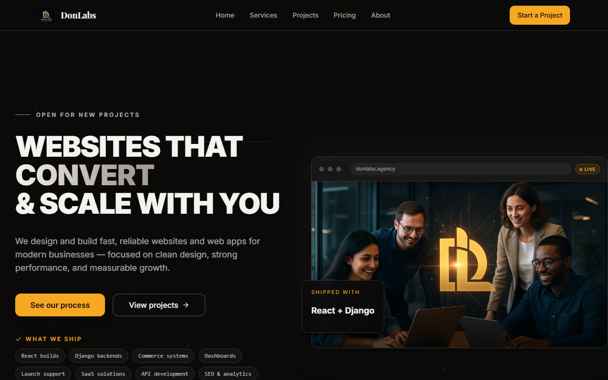
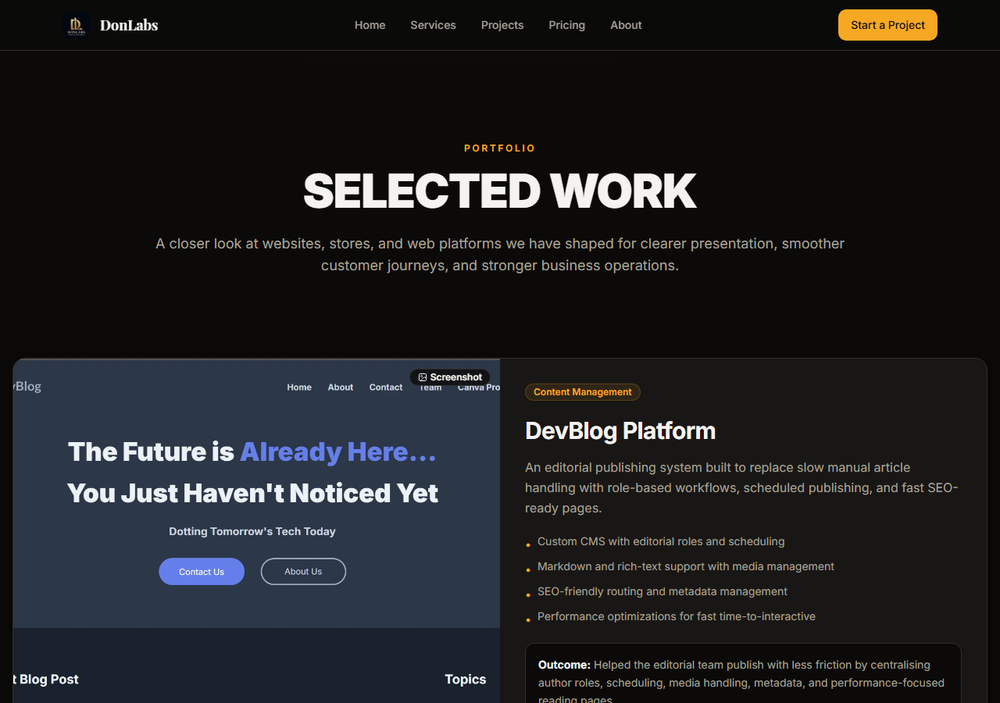
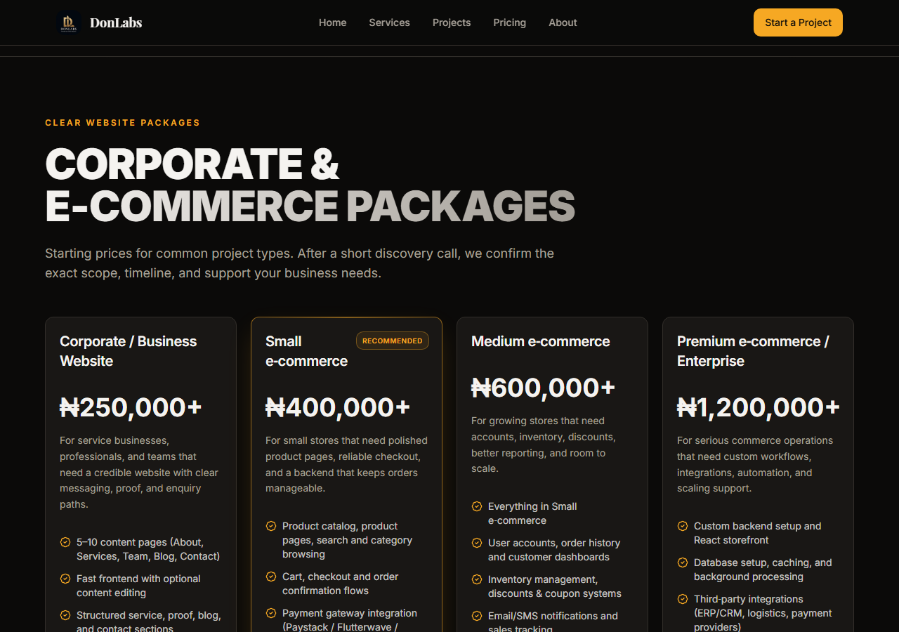

# DonLabs

Agency site for DonLabs — business websites, online stores, and custom web apps.

**Live:** https://donlabs.site

[](https://pagespeed.web.dev/analysis?url=https://donlabs.site/)

## What we sell

- **Business websites** for service brands that need to look credible and turn visits into enquiries.
- **E-commerce** with working checkout (Paystack / Flutterwave / Stripe) plus order and inventory management.
- **Custom web apps** — dashboards, booking flows, portals, marketplaces — and PWAs with offline support and push.

WhatsApp +234 903 138 6928 · samuel@donlabs.site · remote.

## Screenshots

| Home | Services |
| ---- | -------- |
|  |  |
| Projects | Pricing |
|  |  |

## Stack

Site: Vite, React, TypeScript, React Router, Tailwind, shadcn (Radix), Framer Motion, GA4. Hosted on Vercel.

Client work: Python, Django / DRF, Flask, TypeScript, React, Node, Postgres, MySQL, REST APIs. Ships on Vercel / DigitalOcean / AWS.

Not listed on purpose: Celery, Redis, Docker — I know them but haven't shipped production work on them, so they're not claimed here or on the site.

## Dev

```bash
npm install
npm run dev      # local
npm run build    # dist/
```

Needs `VITE_GA4_MEASUREMENT_ID` for analytics. Canonical, OG, sitemap, and robots all point at `https://donlabs.site` — after deploy, confirm `/robots.txt` and `/sitemap.xml` resolve and submit the sitemap in Search Console.

No Lighthouse score committed (run it live via the badge above). GitHub side: set About → Website to `https://donlabs.site` and topics to `web-agency react typescript django ecommerce tailwindcss vite seo vercel remote`.

## License

MIT — see [LICENSE](LICENSE).
